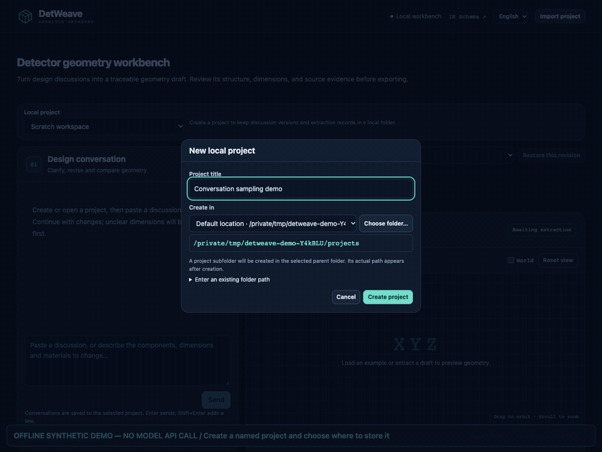

# DetWeave

**From detector discussions to traceable geometry, review questions and simulation inputs.**

[中文说明](README.zh-CN.md) · [Download releases](https://github.com/hengne/DetWeave/releases) · [Citation](CITATION.cff) · [License](LICENSE)

DetWeave is a local workbench for Geant4 users. Paste an unformatted conversation or meeting record, choose a model provider, review the evidence-linked geometry, then export GDML, a Geant4 C++ project or a DD4hep compact XML / detector constructor project.

**Author:** Hengne Li (李衡讷), **South China Normal University (华南师范大学)**.
**Contact:** Hengne.Li@m.scnu.edu.cn · Hengne.Li@cern.ch

## Run the developer web environment — no native compilation

**For developers and AI coding agents: use this path first.** The development UI is
one HTML document served by Python on your own computer. Python connects directly
to model providers and saves projects. No executable, installer, Briefcase, Xcode,
Android SDK, Node.js or externally hosted relay is needed to run this environment.
The `file://` standalone application was withdrawn; this UI requires its local backend.

Prerequisites: Git and Python **3.10+** with pip/venv. From a terminal:

**macOS / Linux**

```sh
git clone https://github.com/hengne/DetWeave.git
cd DetWeave
python3 -m venv .venv
.venv/bin/python -m pip install -e '.[dev]'
.venv/bin/python -m detweave serve --dev-ui --open --port 0
```

**Windows PowerShell**

```powershell
git clone https://github.com/hengne/DetWeave.git
cd DetWeave
py -3 -m venv .venv
.\.venv\Scripts\python.exe -m pip install -e ".[dev]"
.\.venv\Scripts\python.exe -m detweave serve --dev-ui --open --port 0
```

If the checkout already exists, start at `cd DetWeave`; do not clone inside it.
The terminal prints a URL such as `http://127.0.0.1:54725` and opens it automatically.
**Use the actual printed port**, not that example. `--port 0` chooses a free port;
use `--port 8765` for a fixed port. Keep the terminal running; **Ctrl+C stops the service**.
If the browser does not open, paste the printed URL into a browser manually.

In the page, create a project and select its storage folder, expand **Model and
example settings**, then select a provider/model and enter your API key. Settings
auto-save to the backend user's configuration directory, separately from projects.
For an offline workflow test, select a built-in example, send it, then send the
explicit synthetic command `demo change thickness`. This does not test AI understanding.
Real natural-language edits require a provider API.

For debugging:

- Python/backend changes: stop and restart the command. There is no automatic reload.
- HTML/CSS/JavaScript changes: refresh the page; use a hard refresh if necessary.
  `--dev-ui` embeds the current web source into one document on each request.
- Browser developer tools → Console/Network inspect the UI and local `/api/` requests.
  Provider calls happen in Python, so debug them in the backend rather than expecting
  browser requests to the provider. Request bodies may contain API keys; do not share raw captures.
- `python scripts/build_dev_ui.py` optionally exports `dist/DetWeave-dev.html` for inspection.
  **It is not required to run or debug the page**; double-clicking that file does not start Python.
- If project creation/settings saving fails, check permissions on both the selected
  folder and the backend's configuration/registry directories. Sandboxed AI runners
  may lack access even when the folder picker succeeds. Run from your own terminal,
  or set `DETWEAVE_PROJECTS_DIR` and `DETWEAVE_SETTINGS_DIR` to writable directories.
  Do not point tests at real user data.

See [developer details and storage paths](docs/CONVERSATION_DEV.md).
**The source and recording below show the v0.3.0 conversation workflow.**
Use [the v0.3.0 GitHub Release](https://github.com/hengne/DetWeave/releases/tag/v0.3.0) for published installers and their platform validation status. Review handoff and
build gates: [v0.3.0 release preparation](docs/releases/v0.3.0-preparation.md).

## Watch the workflow



[Download the English MP4](docs/media/detweave-demo-en.mp4) · [中文演示](docs/media/detweave-demo-zh.mp4)

The recording uses explicitly labelled synthetic examples. It demonstrates the interface and saved-project workflow; it is not evidence that an arbitrary detector description has passed a live model or Geant4 validation. Real API results are documented separately in [live model verification](docs/LIVE_MODELS.md).

## Get started

Download the asset matching your platform from [GitHub Releases](https://github.com/hengne/DetWeave/releases). Read the release's platform validation table: a source/build project, simulator application and signed device installer are different deliverables. Native build instructions and platform-specific limits are in [packaging/README.md](packaging/README.md).

For the Python distribution, use Python 3.10 or later:

```sh
git clone https://github.com/hengne/DetWeave.git
cd DetWeave
python3 -m venv .venv
source .venv/bin/activate
python -m pip install -e .
python -m detweave serve
```

On Windows, activate with `.venv\Scripts\activate`. Open `http://127.0.0.1:8765` for this browser-based Python edition. The service listens only on this computer. The native edition embeds the Python runtime and opens its own window.

1. Choose **New project** in the left dropdown, enter a title, select a storage location and create a local project. Built-in synthetic examples remain available for offline exploration.
2. Enter the discussion or prompt. Choose a provider and model, then enter your own API key when making a live request.
3. Send a message in the left conversation panel. Concise status and elapsed time show activity; Stop cancels the request. Raw Thinking stays hidden.
4. Reply to clarification questions or request a change. Each geometry revision records its parent and parameter differences; questions without edits retain the current model. Restore an earlier version to continue from it.
5. Inspect the SVG projections and interactive 3D preview. Export only after blocking issues are resolved. Compile and validate generated projects in the intended Geant4/DD4hep environment.

Switch between **English** and **中文** in the interface. Source discussions, model responses and user titles retain their original language.

## Model providers

The catalog includes Volcengine Coding Plan, DeepSeek's official API, Kimi Code, GLM Coding Plan, Alibaba Cloud Token Plan, Tencent General Token Plan, Tencent Hunyuan Hy Token Plan, OpenAI, Anthropic and Google Gemini. It records provider-specific model IDs, endpoint URLs, billing category and official sources, verified on **2026-11-06**.

See [the complete catalog](docs/PROVIDERS.md). Subscription products and metered APIs are separate, and model access depends on the account. Some subscriptions restrict eligible tools; a listed compatible endpoint does not itself establish permission to use that subscription in a custom application. No API keys are bundled, fetched or enrolled by the catalog.

## What is included

| Capability | Current scope |
|---|---|
| Unformatted text | Chinese, English or mixed discussions; selected model extracts the geometry |
| Project history | Named local projects, saved prompt versions, run outcomes, model/validation snapshots and exports |
| Geometry model | Strict JSON Schema; boxes and complete z-axis cylinders/tubes; translations, nesting and repeated arrays |
| Evidence and clarification | Original source quotes, explicit/derived/assumed/unresolved states; unsupported or unresolved requirements block export |
| Checks | Units, dimensions, references, cycles, expansion limits and supported analytic overlaps/containment |
| Visualization | XY/XZ/YZ SVG, rotatable 3D, material colors, selected-component evidence and offline HTML preview |
| Conversation progress | Concise status, elapsed time and cancellation; raw reasoning stays hidden; configurable 60–900 s total limit, default 600 s |
| Exports | GDML with material definitions, Geant4 C++, DD4hep XML + C++, source evidence, hashes, SVG and validation report |
| Native verification tools | Geant4 recursive CheckOverlaps, three-axis navigation, ten-event geantino test and geometry/IR comparisons |

A **draft**, an **exportable model**, and a **backend-validated model** are separate states. Export does not prove physical equivalence or complete correctness. Supported material definitions are a snapshot of 12 Geant4 11.1.3 NIST materials; optical properties, readout, sensitive-detector behavior, fields and energy scoring are not configured.

## Files and privacy

The application stores explicitly created projects locally. Prompt history includes the user's discussion and the extraction system prompt, so project folders and exported ZIPs may contain sensitive research content. API keys and raw model reasoning traces are not written to those project records. Choosing a remote provider sends the discussion to that provider; offline examples and local geometry checks do not.

**2026-11-09: The standalone HTML application has been withdrawn from public distribution.** Direct browser access to Volcengine Coding Plan is blocked by the provider’s CORS configuration, so it does not meet the intended download-and-use workflow. Use a native application from [Releases](https://github.com/hengne/DetWeave/releases/tag/v0.2.0). Experimental source is retained; exported geometry HTML previews remain available.

## License and citation

DetWeave 0.3.0 is **source-available for noncommercial use**, under the [DetWeave Noncommercial Attribution and Citation License 1.0](LICENSE). Commercial use requires separate written authorization from Hengne Li. Keep the author attribution and cite DetWeave in publicly shared work to which it materially contributed.

> Hengne Li. *DetWeave: Conversation-driven detector geometry modelling and validation*. South China Normal University. Version 0.3.0, 2026. https://github.com/hengne/DetWeave

Use the version or commit actually used; [CITATION.cff](CITATION.cff) enables GitHub's citation export. Earlier MIT-licensed development snapshots retain their historical license record in [NOTICE](NOTICE) and [LICENSES/MIT-legacy.txt](LICENSES/MIT-legacy.txt). Third-party components retain their own licenses.

## Development and validation

```sh
python -m pip install -e '.[dev]'
python -m pytest -q
python -m detweave validate examples/sampling.json
python -m detweave export examples/sampling.json --output local/sampling.zip
```

The local workbench never executes model-generated code. Native Geant4/DD4hep checks run separately in the environment you specify. [Validation records](docs/VALIDATION.md) describe tested versions and remaining limits; sample results do not automatically apply to new geometries.

- [Architecture](docs/ARCHITECTURE.md)
- [Provider catalog](docs/PROVIDERS.md)
- [Project storage](docs/PROJECTS.md)
- [Streaming protocol and timeouts](docs/STREAMING.md)
- [Geometry format](docs/FORMAT.md)
- [Roadmap](docs/ROADMAP.md)
- [Native packaging](packaging/README.md)
- [Contributing](CONTRIBUTING.md)

DetWeave is independent software, not an official CERN, Geant4, DD4hep or model-provider product.

### Applications and project locations

Native desktop and mobile applications are available in Releases. New projects require a storage location: desktop apps use a system directory picker, while mobile apps follow platform document permissions. See [delivery formats](docs/DISTRIBUTION.md).
