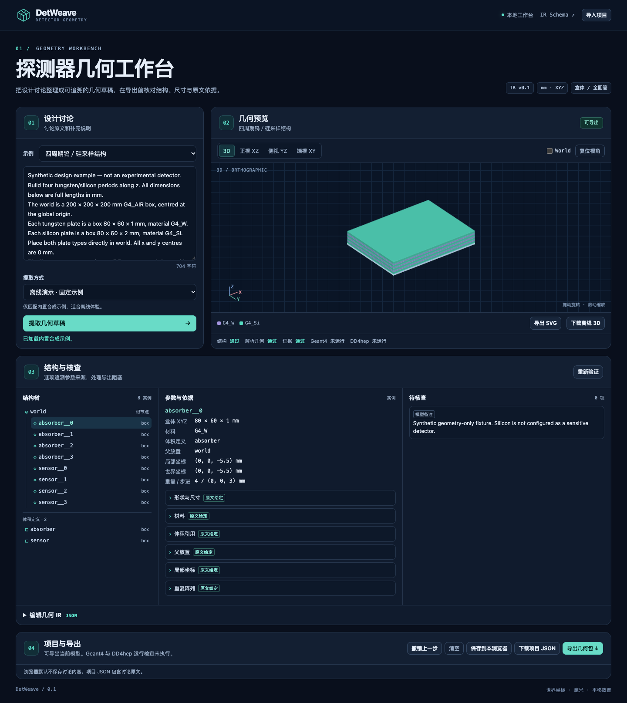

# DetWeave

**Turn detector discussions into traceable geometry, review questions and reproducible simulation inputs.**

DetWeave 是面向 Geant4 用户的对话式探测器几何建模工作台。粘贴会议纪要或聊天记录，
接入你选择的大模型 API，审阅统一几何模型及其原文依据，再导出 GDML、Geant4 C++ 工程
与 DD4hep compact XML / detector constructor。

当前为 **v0.1.1 研究原型**：小型层状量能器、晶体／硅片阵列与简单束流测试几何。
模型草案、可导出模型和实际后端验证是三个独立状态。



## 快速开始

需要 Python 3.10+。网页与预览无 CDN、无前端构建依赖；模型 API 请求通过本机后端发送。

```sh
git clone https://github.com/hengne/DetWeave.git
cd DetWeave
python3 -m venv .venv
source .venv/bin/activate
python -m pip install -e '.[dev]'
python -m detweave serve
```

打开 **http://127.0.0.1:8765**。macOS 可在安装依赖后双击 `Start DetWeave.command`，
或执行 `python -m detweave serve`。服务仅监听本机，不是公开托管站点。

1. 加载“钨／硅采样结构”或“圆管与硅片”内置示例，可在没有 API key 时体验完整导出流程。
2. 处理自己的无格式文本时，选择 API 协议，填写 Base URL、模型标识及 API key。火山用户可直接选择 Coding Plan 预设，并从下拉菜单选择[当前文档中的全部生成模型](docs/ARK_MODELS.md)。
   提取时自动展开“运行过程 / Thinking”，可查看服务商公开的思考片段、几何 JSON、耗时及最近数据时间，也可取消。
3. 审阅部件、参数、引用原文和澄清问题；用补充回答重新抽取，或编辑结构化模型。
4. 查看正投影和可旋转三维模型。关键假设和问题未解决前，工程导出被阻止。
5. 下载项目 ZIP，在目标 Geant4 / DD4hep 环境编译和加载；按随附说明保存实际验证报告。

**离线演示仅使用明确标记的固定合成样例，不会把任意输入偷偷替换为示例。**
真实文本抽取需要有效 API 凭证。火山 Coding Plan 的 `ark-code-latest` 已完成真实中英文采样结构抽取，且实际输出已通过
Geant4 加载与跟踪。实测发现的跨段引用问题已通过多段引用修复；仍保留超时及失败案例，详见[真实模型测试](docs/LIVE_MODELS.md)。
GPT-4 尚未实测；本地模拟协议测试不代表模型理解能力。

## 已实现

| 能力 | v0.1 范围 |
|---|---|
| 多模型 API | OpenAI Chat Completions 兼容、Anthropic Messages、Gemini generateContent；模型 ID 可配置，包括账号可用的 GPT-4；支持 localhost 兼容服务 |
| 流式进度 | 可收起的 Thinking 窗口、公开思考与 JSON 分栏、真实数据活动与本地心跳区分、取消、默认 600 秒可调总时限 |
| 无格式文本输入 | 中文、英文和混合讨论，由所选模型抽取；30,000 字符请求上限 |
| 统一模型 | 严格 JSON Schema；长方体、沿 z 的完整圆柱／圆管；局部平移、层级、重复阵列 |
| 来源与澄清 | 关键参数的原文引用、明确／确认／推导／假设／未解决状态；缺来源或未确认项阻止导出 |
| 验证 | 单位约定、正尺寸、引用、循环、扩展数量、支持形状的解析重叠与越界检查 |
| 可视化 | XY／XZ／YZ SVG、交互三维、材料颜色、部件选择与依据关联、独立离线预览下载 |
| 修改与保存 | 补充回答后再抽取、JSON 编辑、撤销、项目导入／导出；按明确操作保存本机副本 |
| 输出 | 自包含材料 GDML、直接构造几何的 Geant4 C++、DD4hep XML + C++ 插件、来源、SHA-256 清单、SVG、校验报告 |
| 原生验证工具 | Geant4 递归 CheckOverlaps、三条中心轴导航、十事件 geantino 测试、实际几何表与 IR 比对 |

材料快照取自 **Geant4 11.1.3 NIST**。应用只支持 schema 中列出的 12 种材料；
未声明光学属性、敏感体、读出、磁场或能量沉积测量。DD4hep 的材料转换差异和验证状态见
[验证记录](docs/VALIDATION.md)，不能仅凭文件生成就认定不同后端物理等价。

## 命令行与开发

```sh
python -m detweave validate examples/sampling.json
python -m detweave export examples/sampling.json --output local/sampling.zip
python -m pytest -q
# 在已经激活并配置好数据集变量的 Geant4 环境中：
python scripts/validate_backends.py --geant4-prefix /path/to/geant4
```

生成的项目包括 CMake 与运行说明。应用后端不会执行模型生成的代码；原生检查在你指定的
开发环境显式运行。v0.1 尚未把隔离构建队列集成进网页。

API key 仅存在于本次请求／页面内存，不写入项目、日志或浏览器持久存储。
选择远程模型时，**输入全文会发送给配置的服务商**。离线演示和几何验证不发送外部请求。
本地项目 JSON 与 ZIP 会包含原始文本，分享前应自行检查适用范围。费用由模型服务商另计；
公开 GitHub 仓库不附送模型 API 额度。应用不启用自动付费部署或云算力。

- [流式进度、Thinking 与超时](docs/STREAMING.md)
- [架构与功能设计](docs/ARCHITECTURE.md)
- [后续开发路线与验收标准](docs/ROADMAP.md)
- [验证记录及已知边界](docs/VALIDATION.md)
- [模型与后端约定](docs/FORMAT.md)
- [贡献指南](CONTRIBUTING.md)

## 设计依据

DD4hep compact 描述需要配套 detector constructors，见
[DD4hep 官方说明](https://dd4hep.web.cern.ch/usermanuals/DD4hepManual/DD4hepManualch1.html)。
Geant4 的 `CheckOverlaps()` 是带采样和容差配置的检查，见
[Geant4 官方重叠检测文档](https://geant4.web.cern.ch/documentation/pipelines/master/bfad_html/ForApplicationDevelopers/Detector/Geometry/geomOverlap.html)。
图像正常或一次采样通过，都不是对所有重叠、导航或物理配置的完整证明。

MIT license. DetWeave is independent software, not an official CERN, Geant4 or DD4hep product.
