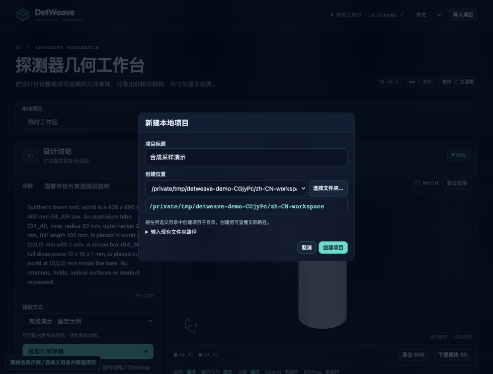

# DetWeave

**把探测器讨论转化为有依据、可审阅、可导出的几何模型。**

[English](README.md) · [下载发行版](https://github.com/hengne/DetWeave/releases) · [引用信息](CITATION.cff) · [使用许可](LICENSE)

DetWeave 是面向 Geant4 用户的本地几何建模工作台。粘贴无格式对话、会议纪要或设计讨论，选择模型服务商，审阅带原文依据的几何草案，再导出 GDML、Geant4 C++ 工程或 DD4hep compact XML 与 detector constructor。

**作者：李衡讷 / Hengne Li**
**单位：华南师范大学 / South China Normal University**
**邮箱：Hengne.Li@m.scnu.edu.cn · Hengne.Li@cern.ch**

## 观看操作演示



[下载中文 MP4](docs/media/detweave-demo-zh.mp4) · [English demonstration](docs/media/detweave-demo-en.mp4)

演示使用明确标记的合成样例，展示操作和项目保存流程，不代表任意探测器描述已经通过真实模型理解或 Geant4 验证。真实接口测试记录另见[模型验证记录](docs/LIVE_MODELS.md)。

## 下载与开始使用

从 [GitHub Releases](https://github.com/hengne/DetWeave/releases) 下载适合本机的文件。请查看发行说明中的平台验证状态：源码构建工程、模拟器程序和签名后的设备安装包是不同交付物。构建步骤和平台限制见[原生打包说明](packaging/README.md)。

运行 Python 版需要 Python 3.10 或以上版本：

```sh
git clone https://github.com/hengne/DetWeave.git
cd DetWeave
python3 -m venv .venv
source .venv/bin/activate
python -m pip install -e .
python -m detweave serve
```

Windows 激活命令为 `.venv\Scripts\activate`。Python 网页版打开 `http://127.0.0.1:8765`，服务仅监听本机。原生应用版内置 Python 运行环境，并使用独立应用窗口。

1. 在左侧下拉列表选择**新建项目**，填写标题并创建本地项目。内置合成示例仍可用于离线体验。
2. 输入设计讨论或提示词，选择服务商和模型。真实调用时由用户自行填入 API Key。
3. 点击提取，**运行过程 / Thinking** 窗口显示服务商实际公开的思考片段、输出、耗时和数据活动，支持取消。
4. 审阅尺寸、材料、原文依据、冲突和澄清问题。补充后再次提取，每次提交的提示词和调用结果都会保留历史版本。
5. 查看 SVG 正投影和交互三维；解决阻塞问题后导出，在目标 Geant4 / DD4hep 环境编译、加载和验证。

界面支持 **中文 / English** 切换；输入原文、模型回复和用户标题保留原语言。

## 模型与订阅目录

已整理火山 Coding Plan、DeepSeek 官方 API、Kimi Code、GLM Coding Plan、阿里云百炼 Token Plan、腾讯通用 Token Plan、腾讯混元 Hy Token Plan，以及 OpenAI、Anthropic、Google Gemini。各入口附有模型 ID、接口地址、计费类别、官方链接，核对日期为 **2026-11-06**。

完整清单见[服务商目录](docs/PROVIDERS.md)。订阅与按量 API 使用不同地址或权限；部分订阅限制适用工具，列出兼容接口不代表自研应用已取得套餐接入资格。模型目录不包含密钥，也不会自动获取密钥或购买套餐。

## 功能范围

| 功能 | 当前支持 |
|---|---|
| 无格式输入 | 中文、英文及混合讨论，由所选模型抽取 |
| 项目历史 | 命名的本地项目、提示词版本、调用结果、模型与校验快照、导出文件 |
| 几何结构 | 严格 JSON Schema；长方体、沿 z 的完整圆柱／圆管；平移、嵌套、重复阵列 |
| 来源与澄清 | 原文引用、明确／推导／假设／未解决状态；关键问题未解决前阻止导出 |
| 检查 | 单位、尺寸、引用、循环、展开数量及支持形状的解析重叠／越界 |
| 可视化 | XY／XZ／YZ SVG、可旋转三维、材料颜色、部件与依据关联、离线 HTML 预览 |
| 运行过程 | 公开 thinking 与 JSON 分栏、取消；默认 600 秒总时限，可调 60–900 秒 |
| 输出 | 自包含材料的 GDML、Geant4 C++、DD4hep XML 与 C++、来源、哈希清单、SVG、校验报告 |
| 原生验证工具 | Geant4 递归 CheckOverlaps、三轴导航、十事件 geantino 测试、实际几何与 IR 比对 |

**草案、可导出、后端已验证**是三个独立状态。成功导出不等于物理等价或几何完全正确。材料为 Geant4 11.1.3 NIST 的 12 种材料快照；当前未配置光学属性、读出、敏感探测器行为、磁场或能量沉积计分。

## 本地文件与数据

明确创建的项目保存到本地目录。提示词历史包括用户讨论和抽取系统提示词，因此项目目录及导出 ZIP 可能含研究内容。API Key 和原始 thinking 不写入项目记录。选择远程模型会把讨论发送给该服务商；离线演示与本地几何检查不发送外部请求。

独立 HTML 预览可脱离 Python 使用，其用途是查看几何。完整应用需要安装或内置运行环境。仅把 Python 源码文本塞进 HTML，不能让当前 socket／线程后端直接在浏览器执行；不同交付方式见[发行形态说明](docs/DISTRIBUTION.md)。

## 许可与引用

DetWeave 0.2.0 采用[非商业署名与引用许可](LICENSE)，是**源码可见、仅允许非商业使用**的软件。商业用途须取得李衡讷的另行书面授权。分发时保留作者署名，公开分享实质使用本软件产生的成果时引用：

> Hengne Li. *DetWeave: Conversation-driven detector geometry modelling and validation*. South China Normal University. Version 0.2.0, 2026. https://github.com/hengne/DetWeave

引用应注明实际使用版本或提交号。[CITATION.cff](CITATION.cff) 提供机器可读引用信息。此前已按 MIT 发布的开发快照保留历史许可记录，见 [NOTICE](NOTICE) 和 [旧版 MIT 许可](LICENSES/MIT-legacy.txt)；第三方依赖仍适用各自许可。

## 开发与验证

```sh
python -m pip install -e '.[dev]'
python -m pytest -q
python -m detweave validate examples/sampling.json
python -m detweave export examples/sampling.json --output local/sampling.zip
```

本地工作台不执行模型生成的程序。Geant4 / DD4hep 原生验证在指定环境中单独运行。[验证记录](docs/VALIDATION.md) 标明已测版本和边界，示例通过不能自动视为用户新模型通过。

- [系统架构](docs/ARCHITECTURE.md)
- [服务商与订阅](docs/PROVIDERS.md)
- [项目存储](docs/PROJECTS.md)
- [流式过程与超时](docs/STREAMING.md)
- [几何格式](docs/FORMAT.md)
- [开发路线](docs/ROADMAP.md)
- [原生打包](packaging/README.md)
- [参与贡献](CONTRIBUTING.md)

DetWeave 是独立软件，不是 CERN、Geant4、DD4hep 或模型服务商的官方产品。
