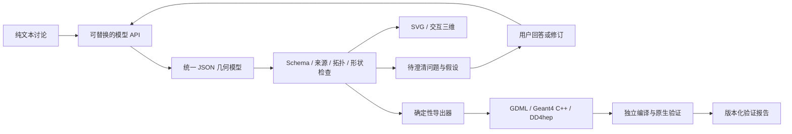

# DetWeave 系统设计

目标：把讨论转化为有依据、可审阅、可重复导出的探测器几何，而不是直接执行模型输出的程序。

## 已落地的模块

- `providers.py`：三种协议适配，固定版本提示、响应上限、超时、一次短暂故障重试；错误不回显服务商响应体，密钥不落盘。模型无工具调用权。
- `schema.json` / `model.py`：封闭 Schema（未知属性拒绝）、mm 全长、局部坐标、实例展开、层级拓扑、来源引文存在性、解析几何检查。
- `exporters.py` / `dd4hep.py`：同一 IR 生成代码、GDML、材料、SVG 与可复现 ZIP；模型不控制模板执行或输出路径。
- `web/`：无构建工具、无外部前端资源；导入导出、审阅、澄清、撤销、SVG 和 Canvas 三维。
- `server.py`：本机工作台 API，只监听 127.0.0.1；Origin/Host/自定义请求头校验，请求体上限和并发限制。
- `scripts/validate_backends.py`：显式执行生成的可信模板，比较 Geant4 实际几何与 IR，再对同一实例的 GDML／C++ 结果作交叉比对。

## 不应合并的三种状态

1. **草案**：可能含错误、缺失、冲突、推导或假设；允许预览，禁止工程导出。
2. **可导出**：Schema、来源存在性、支持范围内的解析几何检查通过；尚未声称后端加载通过。
3. **原生验证结果**：与模型哈希、引擎版本、材料快照、目标软件版本、采样／导航配置绑定的独立结果。

当前网页只展示前两者。仓库中样例的原生结果不能自动转移为用户任意新模型的通过状态。
引文存在性不等于语义正确；一段原文可以包含互相矛盾的说法，研究者仍需审阅参数和原文。

## 下一阶段的后台设计

采用一个应用后端，加可取消、有限资源的独立验证 worker。worker 使用明确版本的
Geant4/DD4hep 镜像，无模型密钥、默认无网络；只读输入、临时工作目录、超时、输出大小限制。
返回带 model_sha256 的机器可读结果，不能覆盖不同版本模型的状态。

API 密钥保存在用户的凭证存储或服务端密钥库，项目只存凭证引用。模型能力配置与协议分开，
支持结构化输出、工具调用、上下文限制和定价版本；未经选择不得自动切换服务商。
大型讨论先分段提取候选事实，再做跨段冲突合并；候选方案形成设计分支，不采用“最后数字获胜”。
